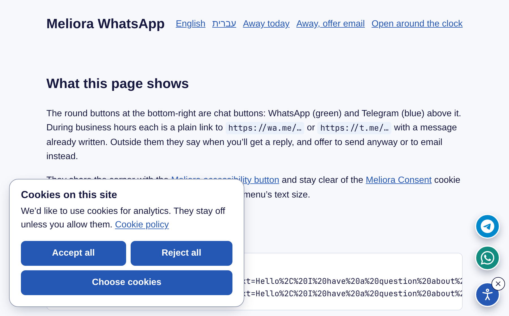
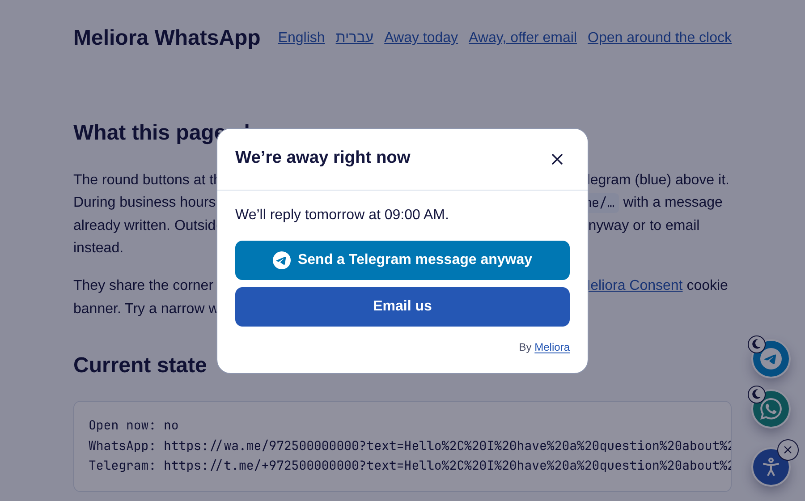
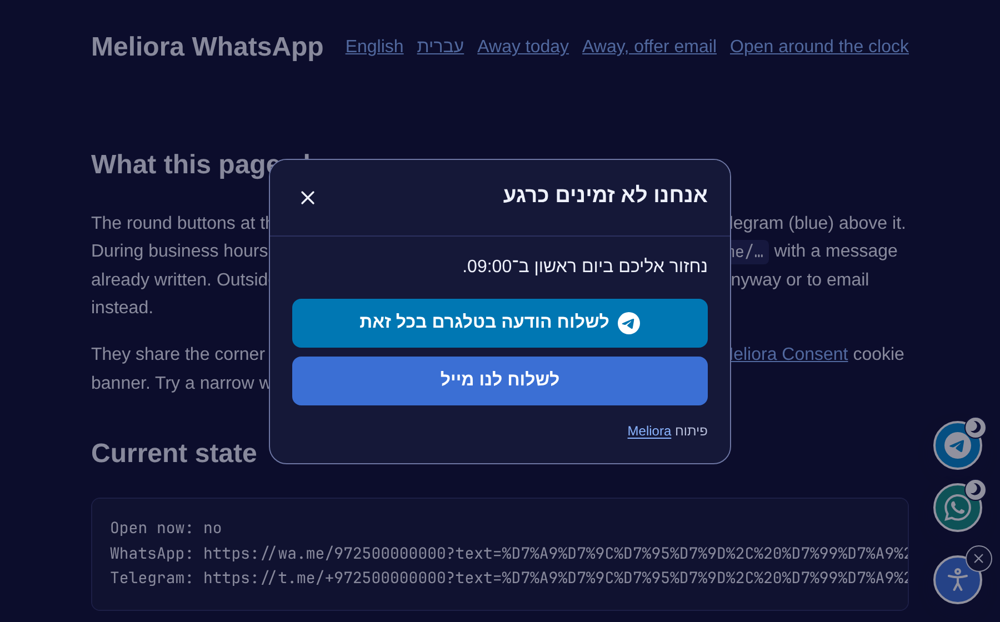
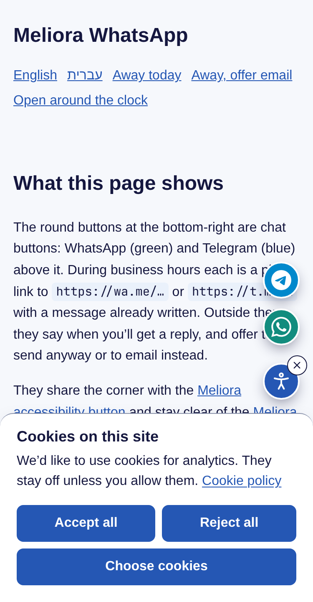

<p align="center">
  
</p>

<h1 align="center">Meliora WhatsApp</h1>

<p align="center">
  Accessible WhatsApp and Telegram chat buttons for any website.<br>
  A real link with a real name · business hours · Hebrew and English · no third-party script · no tracking · no dependencies.
</p>

<p align="center">
  <a href="https://melioradev.github.io/meliora-whatsapp/"><strong>Live demo</strong></a> ·
  <a href="#install">Install</a> ·
  <a href="#configuration">Configuration</a> ·
  <a href="#license">License</a>
</p>

<p align="center">
  
  &nbsp;
  
</p>
<p align="center">
  
  &nbsp;
  
</p>

---

WhatsApp is how most customers contact businesses in Israel, and most WhatsApp buttons on websites are a `<div>` with a click handler and no name, so screen reader and keyboard users can't use them. This one is a plain link. It does Telegram too: WhatsApp, Telegram, or both, stacked in one corner.

## What it does

- **A real link.** During business hours the button is an `<a href="https://wa.me/972…?text=…">`, named "Chat with us on WhatsApp (opens in a new tab)". The visitor sees the message before sending it.
- **Telegram too.** Set `telegram` to your username and a second button links to `https://t.me/<username>?text=…`, named "Chat with us on Telegram (opens in a new tab)". With both, Telegram sits above WhatsApp and the two move as one.
- **Business hours.** Outside them each button becomes a `<button>` with a small moon badge. It opens a dialog that says when you'll reply ("We'll reply tomorrow at 09:00", "on Sunday at 09:00"), and offers to send anyway (in the app the visitor chose), to email instead, or only to email. The dialog follows your time zone, not the visitor's, and names it when they differ. It switches by itself at opening and closing time.
- **Accessible:** keyboard-first, WCAG 2.1 AA / IS 5568, a 44×44 px target, a two-colour focus ring that shows on light and dark pages, the WhatsApp icon at 4.1:1 on WhatsApp's teal, and the Telegram icon at 3.9:1 on Telegram's classic blue. The dialog is a native `<dialog>` with a focus trap and Esc, and focus goes back to the button.
- **Hebrew and English**, following the page's `<html lang>`, with right-to-left Hebrew.
- **Shares the corner.** It stacks on the [Meliora accessibility button](https://github.com/melioradev/meliora-accessibility), centred above it at the bottom-right, and moves up whenever the [Meliora Consent](https://github.com/melioradev/meliora-consent) cookie banner would be under it. It never covers either, at any width and at 200% text (tested). If the visitor drags the accessibility button somewhere else, the chat buttons follow and stay lined up with it; if they hide it, they take the corner. On a short screen with large text they sit beside the accessibility button, level with it (two buttons side by side).
- **No tracking.** No third-party script, no requests, no cookies, no storage. WhatsApp or Telegram only hears about the visit if the visitor follows the link (`rel="noopener noreferrer"`, so not even the referring page).
- **Strict CSP friendly:** no inline scripts or styles.
- **Follows the panel's settings:** High contrast, text size, and your site's colour tokens (`--ink`, `--surface`, `--button`, `--focus`…).

## Install

Copy `src/meliora-whatsapp.js` and `src/meliora-whatsapp.css` to your site, then:

```html
<link rel="stylesheet" href="/meliora-whatsapp/meliora-whatsapp.css">
<script src="/meliora-whatsapp-config.js"></script>
<script src="/meliora-whatsapp/meliora-whatsapp.js" defer></script>
```

with `/meliora-whatsapp-config.js` (a separate file, so a strict CSP needs no `'unsafe-inline'`):

```js
window.MelioraWhatsAppConfig = {
  phone: '972501234567',
  message: {he: 'שלום, יש לי שאלה', en: 'Hello, I have a question'},
  hours: {sun: '09:00-17:00', mon: '09:00-17:00', tue: '09:00-17:00', wed: '09:00-17:00', thu: '09:00-17:00', fri: '09:00-13:00'},
  email: 'hello@example.com',
  telegram: 'your_username', // optional: a Telegram button as well (or on its own, without `phone`)
};
```

The button is added at the end of `<body>`, so it comes last in the Tab order, after the page.

## Configuration

| Setting | Default | What it does |
|---|---|---|
| `phone` | none | Your WhatsApp number in international format, digits only: `972501234567`, not `050-123-4567`. Spaces, dashes, brackets and a leading `+` or `00` are removed for you. A local number is ignored and the console says why. |
| `telegram` | none | Your Telegram username: `acme_support`, `@acme_support` or `https://t.me/acme_support` (as Telegram allows: 4–32 letters, digits and underscores, starting with a letter, not ending with an underscore). Or a phone number, `+972501234567`, which only opens if your Telegram privacy settings let people find you by number (Settings › Privacy and Security › Phone Number › Who can find me by my number), so a username is more reliable. Or a private group's invite link, `https://t.me/+AbCdEf…` (or `https://t.me/joinchat/…`): visitors are asked to join the group, and Telegram doesn't take a pre-filled message there. Set `phone`, `telegram` or both. A value that can't be used is ignored with one console warning; with no usable app, nothing is added. |
| `message` | none | The pre-filled message, for both apps: a string, or `{he: '…', en: '…'}`. Telegram fills it in for a person, a business account or a group, not for a channel, where visitors can't write. `{title}` and `{url}` are replaced with the page title and address (without the query string), so you know which page they wrote from. |
| `name` | none | Your business name in the buttons' names: "Chat with Acme on WhatsApp", "Chat with Acme on Telegram". A string or `{he, en}`. |
| `hours` | always open | Opening hours per day: `sun`, `mon`, `tue`, `wed`, `thu`, `fri`, `sat`. Each is `'09:00-17:00'`, several ranges `'09:00-13:00, 16:00-19:00'`, or missing for a closed day. Use `'00:00-24:00'` for all day. Split a range that crosses midnight: `fri: '22:00-24:00', sat: '00:00-02:00'`. |
| `timeZone` | `'Asia/Jerusalem'` | The time zone your hours are in. |
| `closedDates` | `[]` | Days off, as `'2026-12-25'` in your time zone. Holidays, for example. |
| `afterHours` | `'notice'` | Outside hours: `'notice'` says when you'll reply and offers the app anyway (and email, with `email`); `'email'` offers only email (needs `email`); `'off'` keeps the plain links. |
| `email` | none | Address for the "Email us" option. |
| `emailSubject` | none | Subject for that email: a string or `{he, en}`. |
| `text` | | Override any string, per language: `{he: {chat: '…'}, en: {…}, default: {…}}`. Keys are in the `I18N` object at the top of the script. |
| `avoid` | none | CSS selectors of other fixed elements at the bottom-right that the buttons should climb above. |
| `insertAfter` | none | CSS selector to place the buttons after in the DOM, instead of at the end of `<body>`. |

Telegram Business accounts can also set opening hours and an away message inside Telegram. The two work together: the dialog tells visitors before they leave your page, and Telegram's away message answers anyone who writes anyway.

### Colours

The button is `--whatsapp-bg` (default WhatsApp's teal, `#128c7e`: 4.1:1 with the white icon) and `--whatsapp-bg-hover` (`#075e54`).

> **WhatsApp's bright green:** you can switch to it, but white on `#25d366` is only 2:1, below the 3:1 that WCAG 2.1 (1.4.11) and IS 5568 ask of an icon that identifies a control:
>
> ```css
> :root { --whatsapp-bg: #25d366; --whatsapp-bg-hover: #1da851; }
> ```
>
> The accessibility panel's High contrast setting always turns the button black and white, whatever you choose.

 The "Send a WhatsApp anyway" button in the dialog has text, which needs 4.5:1, so it uses WhatsApp's dark teal `--whatsapp-text-bg` (default `#075e54`, 7.6:1) and `--whatsapp-text-bg-hover`. If you pick other colours, keep white on them at 3:1 or more.

Telegram works the same way: `--telegram-bg` (default `#0088cc`, Telegram's classic blue: 3.9:1 with the white icon) and `--telegram-bg-hover` (`#0077b3`), and `--telegram-text-bg` (`#0077b3`, 4.9:1) and `--telegram-text-bg-hover` (`#00679e`) for "Send a Telegram message anyway". Telegram's current light blue, `#26a5e4`, is only 2.8:1 with white, below the 3:1 for an icon. The dialog follows the same tokens as the accessibility panel and cookie banner (`--ink`, `--surface`, `--line`, `--button`, `--focus`…).

### The WhatsApp icon

The icon is WhatsApp's own glyph, unaltered (path data from [Simple Icons](https://simpleicons.org/), CC0). WhatsApp and its logo are trademarks of WhatsApp LLC / Meta. Their [brand guidelines](https://www.whatsappbrand.com/) allow the icon on a link that starts a WhatsApp chat, as long as it isn't changed, so don't redraw or recolour the glyph itself; the background colour is yours to set.

The Telegram icon is Telegram's own paper-plane logo, also unaltered, from the same source. Telegram and its logo belong to Telegram. It is used here only on a link that opens a Telegram chat; keep the glyph as it is.

## JavaScript API

| Call | Returns |
|---|---|
| `MelioraWhatsApp.url(app)` | The `https://wa.me/…` or `https://t.me/…` link, with the message filled in. `app` is `'whatsapp'` or `'telegram'`; without it, WhatsApp when it is set up, else Telegram. `null` for an app that isn't set up. |
| `MelioraWhatsApp.isOpen()` | `true` during business hours (always `true` without `hours`). |
| `MelioraWhatsApp.open(app)` | Opens the chat, or the "We're away" dialog outside hours. For your own "Contact us on WhatsApp" or "on Telegram" link elsewhere on the page. |
| `MelioraWhatsApp.refresh()` | Re-checks the hours now. |

There are no click events: the button doesn't count anything, and doesn't help anyone else count.

## Placement in detail

Corners are shared by three Meliora tools:

| Element | Where |
|---|---|
| Accessibility button | Bottom-right, `z-index: 60`. Lifts by `--meliora-consent-inset` above the banner sheet. |
| Cookie banner | A card at the bottom-left when there is room beside the accessibility button, otherwise a full-width sheet at the bottom (`z-index: 59`). |
| WhatsApp and Telegram buttons | One stack, Telegram above WhatsApp, centred above the accessibility button, wherever it is (`z-index: 58`). Without one, the bottom-right corner. |

The script measures rather than guesses. The chat buttons move as one block (a column of one or two buttons, 0.75rem apart). With the accessibility button on the page, the block is centred on it, 0.75rem above it (and its ×), climbing past the banner card or sheet and anything in `avoid`. If there's no room above, it goes below, then beside it, level with it; beside it, two buttons go side by side, so the block stays level, with WhatsApp next to the accessibility button in English and Hebrew alike. Without the accessibility button, or with no room around it, the block starts at the corner and climbs the same way; two buttons that don't fit there as a column go side by side, WhatsApp nearest the corner. It re-measures when the banner appears, resizes or goes away, when the accessibility button is hidden, shown or dragged, when the text size changes, and on resize. When the visitor drags the accessibility button, WhatsApp waits for the drop, then lines up with it again.

The accessibility panel's short confirmation toast (shown for 2.5 seconds when a setting changes by keyboard shortcut with the panel closed) appears over the WhatsApp button's position. It sits above the buttons and doesn't take clicks, so nothing is lost.

## Development

```bash
npm install
npm test              # Playwright: Chromium, Firefox and WebKit, served with a strict CSP
npm run serve         # the demo on http://127.0.0.1:8794/
npm run vendor        # copy Meliora Accessibility and Meliora Consent from node_modules into vendor/
npm run check         # vendor/ matches package.json, and the script parses
npm run screenshots   # regenerate docs/screenshots/
```

The demo and the tests load the published builds of Meliora Accessibility and Meliora Consent from `vendor/`, so they check the button against what sites actually install.

The Hebrew strings need a native speaker's review before launch.

## License

MIT with visible attribution: see [LICENSE](LICENSE). The small "By Meliora" line at the bottom right of the "We're away" dialog ("פיתוח Meliora" in Hebrew), with "Meliora" linking to [melioranovotech.com](https://melioranovotech.com), must stay. A site that sets no business hours never shows that dialog, so it must show the credit somewhere else, such as its footer or accessibility statement.

Source: [github.com/melioradev/meliora-whatsapp](https://github.com/melioradev/meliora-whatsapp).

Made by [Meliora Novotech Ltd](https://melioranovotech.com).
